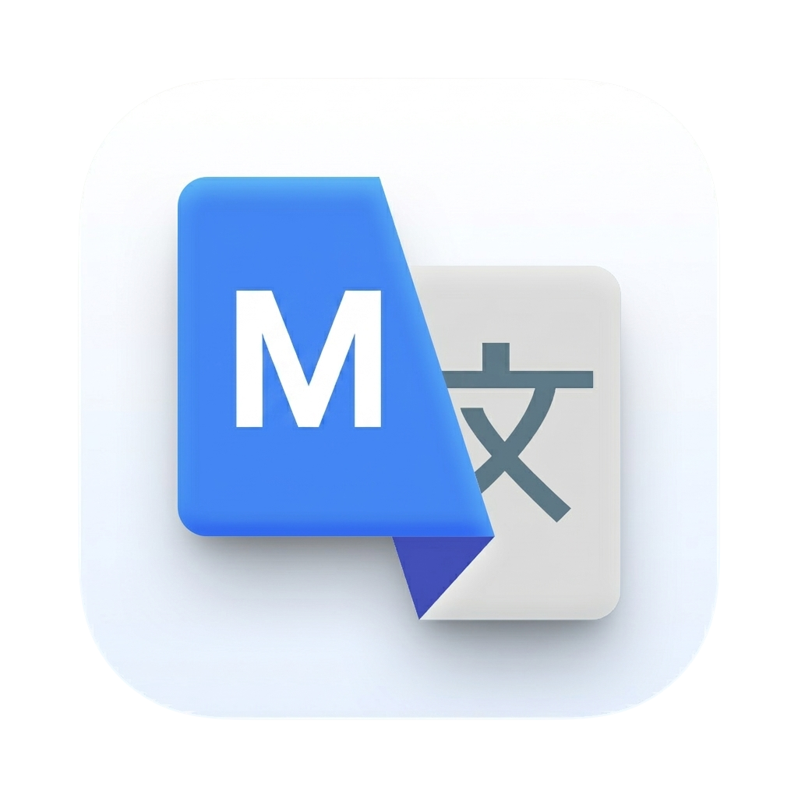
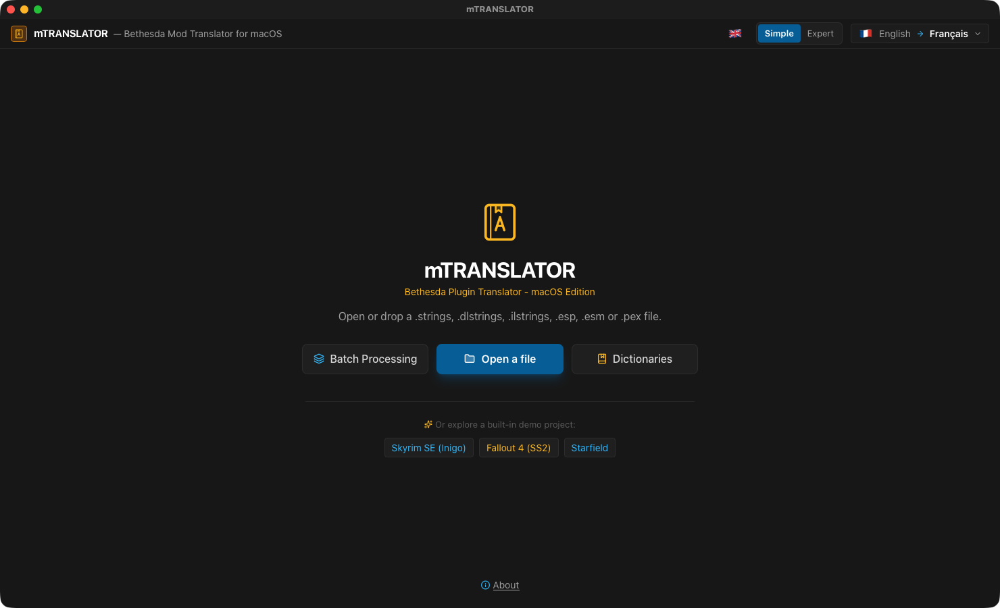
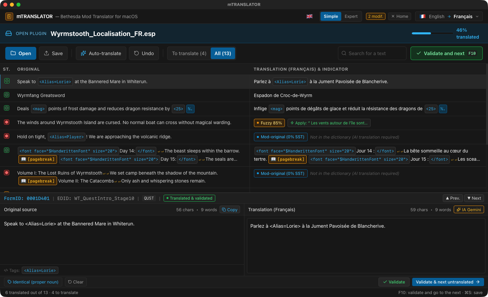

<p align="center"></p>

# mTRANSLATOR

**Translation suite for Bethesda mods (Skyrim SE, Fallout 4, Starfield), native on macOS.**  
*Suite de traduction de mods Bethesda (Skyrim SE, Fallout 4, Starfield), native sur macOS.*

🇬🇧 [English](#-english) · 🇫🇷 [Français](#-français)

---
## 🇬🇧 English

### What it does

mTRANSLATOR opens Bethesda plugins (.esp, .esm, .esl) and string tables, and lets you translate them with xTranslator-compatible SST dictionaries, a self-learning local memory and optional machine translation (Google Translate or Gemini), while protecting game tags. It is inspired by the reference Windows tool xTranslator (by McGuffin) and rebuilt for the Mac.

### Features

- Native reading and writing of **.esp / .esm / .esl** plugins and **.strings / .dlstrings / .ilstrings** tables, plus MCM `.txt` files.
- **SST dictionaries** (xTranslator format): exact matches applied instantly, close matches suggested for review.
- **Self-learning local memory**: every validated line is remembered and reused first in your next mods.
- **Machine translation**: free Google Translate, or Gemini with your own key; tags such as `<Alias=…>`, `[pagebreak]` and Papyrus variables are protected.
- **Batch processing**: translate several plugins at once with the dictionaries, AI for the rest.
- Find & replace (with regex), statistics and report, diff between two versions of a mod.
- Exports: translated plugin (with timestamped backup), SST, xTranslator XML, CSV, TXT, JSON.
- Interface language independent from the translation language (FR, EN, IT, ES).
- Interface in **English, French, Italian and Spanish** (follows your Mac's language; can be changed in the app).

### What's new in 1.0.1


### Updates

From version 1.0.1 the app checks once a day whether a newer release exists on GitHub and offers to open the Nexus page, remind you later or skip that version. Nothing is downloaded or installed automatically. The full history is in [CHANGELOG.md](CHANGELOG.md).

### Screenshots


*Welcome screen*


*Translation table, tag protection and line editor*

### Requirements

A Mac with **Apple Silicon** (M1 or later), **macOS 11 Big Sur** or later. No Python, no Wine, no virtual machine needed.

### Installation

1. Download the zip from Nexus Mods (or from the GitHub releases) and unzip it.
2. Move **mTRANSLATOR.app** to your **Applications** folder.

### How to use

1. Choose the translation language with the **English → …** button at the top right (the flag next to it sets the interface language).
2. Click **Open a file** (or drop a plugin on the window). Try a built-in demo project first if you like.
3. Click **Translate with the SST dictionaries** to fill in everything the official dictionaries know.
4. Translate the remaining lines by hand (F10 validates and moves to the next one) or with **Auto-translate**.
5. Click **Save** (⌘S): overwrite with a backup, save a copy, or download a ZIP pack.

### FAQ

**Where do I get SST dictionaries?**  
Use the official ones extracted from the game with xTranslator, or build your own from your translations (Dictionaries → Create).

**Is a Gemini key required?**  
No. Without a key, free Google Translate is used. The Gemini key (free at aistudio.google.com) gives better results for dialogues and books.

### Privacy

Plugins and dictionaries stay on your Mac. Only the texts you send to machine translation leave it (to Google). The Gemini key is kept on this Mac.

### Building from source

Requires Python 3.12 with PyQt6 and PyInstaller. From the repository folder:

```bash
./build_app.sh
```

→ [docs/DEVELOPMENT.md](docs/DEVELOPMENT.md)

### License

Released under the **MIT License**: free to use, modify and share. Part of the **Skyrim Mac Toolkit**, a set of modding tools built for Skyrim players on Mac.

---

## 🇫🇷 Français

### À quoi ça sert

mTRANSLATOR ouvre les plugins Bethesda (.esp, .esm, .esl) et les tables de chaînes, et permet de les traduire avec des dictionnaires SST compatibles xTranslator, une mémoire locale qui apprend toute seule et une traduction automatique facultative (Google Traduction ou Gemini), en protégeant les balises du jeu. Il s'inspire de l'outil Windows de référence xTranslator (de McGuffin), reconstruit pour le Mac.

### Fonctions

- Lecture et écriture natives des plugins **.esp / .esm / .esl** et des tables **.strings / .dlstrings / .ilstrings**, ainsi que des fichiers `.txt` de MCM.
- **Dictionnaires SST** (format xTranslator) : correspondances exactes appliquées instantanément, correspondances proches proposées à la relecture.
- **Mémoire locale qui apprend** : chaque ligne validée est retenue et réutilisée en priorité sur vos mods suivants.
- **Traduction automatique** : Google Traduction gratuit, ou Gemini avec votre clé ; les balises `<Alias=…>`, `[pagebreak]` et variables Papyrus sont protégées.
- **Traitement par lots** : traduisez plusieurs plugins d'un coup avec les dictionnaires, l'IA pour le reste.
- Rechercher/remplacer (avec regex), statistiques et rapport, comparaison entre deux versions d'un mod.
- Exports : plugin traduit (avec sauvegarde horodatée), SST, XML xTranslator, CSV, TXT, JSON.
- Langue de l'interface indépendante de la langue de traduction (FR, EN, IT, ES).
- Interface en **français, anglais, italien et espagnol** (suit la langue du Mac ; modifiable dans l'appli).

### Nouveautés de la 1.0.1


### Mises à jour

À partir de la version 1.0.1, l'appli vérifie une fois par jour si une version plus récente existe sur GitHub et propose d'ouvrir la page Nexus, de rappeler plus tard ou d'ignorer cette version. Rien n'est téléchargé ni installé automatiquement. L'historique complet est dans [CHANGELOG.md](CHANGELOG.md).

### Captures d'écran


*Écran d'accueil*


*Table de traduction, protection des balises et éditeur de ligne*

### Configuration requise

Un Mac **Apple Silicon** (M1 ou plus récent), **macOS 11 Big Sur** ou plus récent. Ni Python, ni Wine, ni machine virtuelle.

### Installation

1. Téléchargez le zip sur Nexus Mods (ou dans les releases GitHub) et décompressez-le.
2. Placez **mTRANSLATOR.app** dans votre dossier **Applications**.

### Utilisation

1. Choisissez la langue de traduction avec le bouton **English → …** en haut à droite (le drapeau à côté règle la langue de l'interface).
2. Cliquez sur **Ouvrir un fichier** (ou déposez un plugin sur la fenêtre). Essayez d'abord un projet de démo si vous voulez.
3. Cliquez sur **Traduire avec les dictionnaires SST** pour remplir tout ce que connaissent les dictionnaires officiels.
4. Traduisez les lignes restantes à la main (F10 valide et passe à la suivante) ou avec **Traduire automatiquement**.
5. Cliquez sur **Enregistrer** (⌘S) : écraser avec sauvegarde, enregistrer une copie ou télécharger un pack ZIP.

### Questions fréquentes

**Où trouver des dictionnaires SST ?**  
Utilisez les dictionnaires officiels extraits du jeu avec xTranslator, ou créez les vôtres à partir de vos traductions (Dictionnaires → Créer).

**Faut-il une clé Gemini ?**  
Non. Sans clé, Google Traduction gratuit est utilisé. La clé Gemini (gratuite sur aistudio.google.com) donne de meilleurs résultats pour les dialogues et les livres.

### Confidentialité

Les plugins et dictionnaires restent sur votre Mac. Seuls les textes envoyés à la traduction automatique en sortent (vers Google). La clé Gemini reste sur ce Mac.

### Compiler depuis les sources

Nécessite Python 3.12 avec PyQt6 et PyInstaller. Depuis le dossier du dépôt :

```bash
./build_app.sh
```

→ [docs/DEVELOPMENT.md](docs/DEVELOPMENT.md)

### Licence

Publié sous **licence MIT** : libre d'utilisation, de modification et de partage. Fait partie du **Skyrim Mac Toolkit**, un ensemble d'outils de modding pensés pour les joueurs de Skyrim sur Mac.
